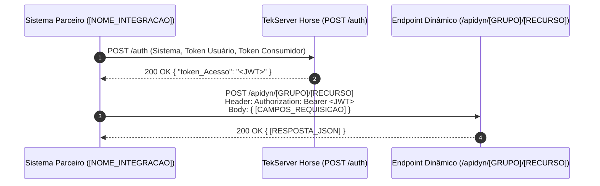

# Documentação Técnica de Integração API — [NOME_INTEGRACAO]

Esta documentação descreve o fluxo de autenticação e consumo do endpoint de **[TITULO_FUNCIONALIDADE]** do ERP **Tek-System**, disponibilizado no servidor base: **`http://[IP_OU_DOMINIO]:[PORTA]`**.

---

## 1. Visão Geral e Parâmetros de Conexão

O fluxo de comunicação é composto por duas etapas obrigatórias:
1. **Autenticação (`POST /auth`)**: Envio do código do sistema, Token do Usuário e Token Consumidor para emissão do token JWT de sessão (`token_Acesso`).
2. **Execução do Endpoint (`POST /apidyn/[GRUPO]/[RECURSO]`)**: Chamada da funcionalidade de negócio via protocolo HTTP/REST, autenticada via *Bearer Token* (`Authorization: Bearer <token_Acesso>`).



### Endereço Base e Credenciais da Integração

| Variável | Valor de Exemplo / Configuração | Obrigatório | Descrição |
| :--- | :--- | :---: | :--- |
| `{{url}}` | `http://[IP_OU_DOMINIO_EXTERNO]:[PORTA]` | Sim | Endereço base de acesso ao serviço HTTP API no TekServer Horse. |
| `{{consumidor}}` | `REC-XXXXXXXX-XXXX-XXXX-XXXX-XXXXXXXXXXXX` | Sim | Token Consumidor habilitado no Tek-System para a integração. |
| `{{token_usuario}}` | `[TOKEN_DO_USUARIO_ERP]` | Sim | Token de identificação do usuário configurado no cadastro de usuários do ERP. |
| `{{tek_acess_token}}` | `[TOKEN_JWT_SESSAO]` | Sim (etapa 2) | Token JWT retornado no atributo `token_Acesso` pela rota `/auth`. |

> [!IMPORTANT]
> **Parâmetros Oficiais de Conexão:**
> - **Servidor Base (TekServer Horse / IP Externo)**: `http://[IP_OU_DOMINIO_EXTERNO]:[PORTA]`
> - **Token Consumidor (`consumidor`)**: `REC-XXXXXXXX-XXXX-XXXX-XXXX-XXXXXXXXXXXX`
> - **Módulo / Sistema**: `1` (ou código do módulo correspondente no ERP)

### Pré-requisitos Obrigatórios de Sistema, Rede e Infraestrutura

> [!WARNING]
> **Configurações obrigatórias no ambiente Tek-System antes de iniciar a integração:**
> 1. **Instalação da Funcionalidade via Marketplace**: É indispensável a instalação prévia da funcionalidade correspondente através do **Marketplace da Tek-System** (*SoftwareCenter*). Essa instalação é o procedimento responsável por registrar o componente e a API Dinâmica (`[CODIGOTEKSYSTEM_APIDIN]` / rota `/apidyn/[GRUPO]/[RECURSO]`) no banco de dados e catálogo do ERP/BI.
> 2. **Liberação do Usuário na API Dinâmica Instalada**: Além de o usuário estar cadastrado no ERP e com token gerado para a integração (`{{token_usuario}}`), esse usuário **deve ser expressamente liberado na aba de "Usuários Autorizados" dentro da API Dinâmica instalada pela funcionalidade** (no cadastro de APIs Dinâmicas do BI / `GeradorRelatorioMC`).
>    - *Atenção*: Se o usuário não estiver liberado na lista de usuários autorizados da rota, as requisições retornarão erro de permissão (401/403), mesmo que a autenticação inicial em `/auth` tenha ocorrido com sucesso.
> 3. **Configuração do TekServer Horse e Liberação de Porta**: O serviço HTTP responsável pelas APIs deve estar devidamente configurado e em execução no **TekServer Horse**. A **porta configurada (ex: `8080`)** deve estar liberada no Firewall local do servidor (Regras de Entrada / *Inbound Rules*) e com o devido redirecionamento de portas (*Port Forwarding* / NAT) ativo no roteador ou firewall de borda da rede.
> 4. **Liberação de IP Externo para Conexão**: O **IP externo público** (ou FQDN/DNS) do servidor onde o TekServer Horse está hospedado deve estar liberado para receber conexões da internet. Caso o ambiente possua firewall restritivo com lista de permissões (*whitelist*), os IPs externos de origem dos servidores parceiros devem ser liberados para tráfego na porta da API.

---

## 2. Rota de Autenticação (`/auth`)

Responsável por validar as credenciais do usuário e o Token Consumidor no servidor Tek-System e emitir o token JWT de sessão (`token_Acesso`) com tempo de expiração controlado.

- **Nome no Postman**: `Auth`
- **Método HTTP**: `POST`
- **URL**: `http://[IP_OU_DOMINIO_EXTERNO]:[PORTA]/auth` (ou `{{url}}/auth`)
- **Autenticação**: Nenhuma (*No Auth* — credenciais enviadas diretamente no corpo da requisição)

### Headers

| Chave | Valor | Obrigatório |
| :--- | :--- | :---: |
| `Content-Type` | `application/json` | Sim |

### Body da Requisição (`application/json`)

```json
{
  "Sistema": 1,
  "Token": "{{token_usuario}}",
  "consumidor": "{{consumidor}}"
}
```

#### Descrição dos Parâmetros de Envio (`/auth`)

| Campo | Tipo | Obrigatório | Descrição |
| :--- | :--- | :---: | :--- |
| `Sistema` | `integer` | Sim | Código identificador do módulo no Tek-System (`1` = Faturamento / ERP). |
| `Token` | `string` | Sim | Token do usuário cadastrado no ERP Tek-System (`{{token_usuario}}`). |
| `consumidor` | `string` | Sim | Token Consumidor habilitado no ERP para o parceiro (`{{consumidor}}`). |

### Resposta de Sucesso (`200 OK` — `application/json`)

```json
{
  "token_Acesso": "eyJ0eXAiOiJKV1QiLCJhbGciOiJIUzI1NiJ9.eyJpc3MiOiJUZWstU3lzdGVt...<JWT>"
}
```

> [!TIP]
> **Script Pós-Resposta Configurado no Postman (Tests / After Response):**
> ```javascript
> const response = pm.response.json();
> if (pm.response.code >= 200 && pm.response.code < 300) {
>     pm.collectionVariables.unset("tek_acess_token");
>     pm.collectionVariables.set("tek_acess_token", response.token_Acesso);
>     console.log("Token adicionado com sucesso!");
> } else {
>     console.log("Falha ao logar conta, o token não foi recuperado");
> }
> ```

---

## 3. Rota Dinâmica: [TITULO_FUNCIONALIDADE] (`/apidyn/[GRUPO]/[RECURSO]`)

Endpoint dinâmico configurado no módulo de BI (`GeradorRelatorioMC`). [DESCRICAO_DO_OBJETIVO_DA_ROTA].

### Metadados Técnicos no BI (Cadastro de APIs Dinâmicas)

| Propriedade no BI / Postman | Valor Configurado |
| :--- | :--- |
| **Descrição** (`DESCRICAO_APIDIN`) | `[TEK] [DESCRICAO_DA_FUNCIONALIDADE]` |
| **Código Tek-System** (`CODIGOTEKSYSTEM_APIDIN`) | `[CODIGO_XML_DO_COMPONENTE]` |
| **Autor** (`AUTOR_APIDIN`) | `TEK-SYSTEM` |
| **Método HTTP** (`METODOHTTP_APIDIN`) | `POST` (ou `GET`) |
| **Grupo** (`GRUPO_APIDIN`) | `[GRUPO]` (ex: `tek`, `ecommerce`, `ssw`) |
| **Recurso** (`RECURSO_APIDIN`) | `[RECURSO]` (ex: `confirmar_entrega`, `consultar_pedido`) |
| **URL Completa** (`Path`) | `http://[IP_OU_DOMINIO]:[PORTA]/apidyn/[GRUPO]/[RECURSO]` |
| **Pública** (`PUBLICA_APIDIN`) | `S` (Sim) |
| **Requer Autenticação** (`REQUER_AUTENTICACAO_APIDIN`) | `S` (Sim — Bearer Token) |
| **Header de Autenticação** | `Authorization: Bearer {{tek_acess_token}}` |
| **Direcionamento (Unit.Método)** (`DIRECIONAMENTO_APIDIN`) | `[UNIT_DELPHI].[METODO_PASCAL]` |
| **Tipo de Conteúdo de Retorno** | `application/json` (Registra Log: `S`) |
| **Origem / Instalação** | Instalação prévia obrigatória via **Marketplace Tek-System** (*SoftwareCenter*) |
| **Liberação de Usuários** | Usuário da integração deve estar vinculado na aba **Usuários Autorizados** da API Dinâmica |
| **Servidor / Infraestrutura** | Serviço **TekServer Horse** com porta (`[PORTA]`) e IP externo liberados |

### Especificação da Requisição

- **Método HTTP**: `POST`
- **URL**: `http://[IP_OU_DOMINIO]:[PORTA]/apidyn/[GRUPO]/[RECURSO]`
- **Autenticação**: `Bearer Token` (`{{tek_acess_token}}`)

### Headers

| Chave | Valor | Obrigatório |
| :--- | :--- | :---: |
| `Authorization` | `Bearer {{tek_acess_token}}` | Sim |
| `Content-Type` | `application/json` | Sim |

### Body da Requisição (`application/json`)

```json
{
  "campo_identificador": "VALOR_EXEMPLO",
  "numero_documento": 12345,
  "ativo": true
}
```

#### Parâmetros de Entrada no Body

| Campo | Tipo | Obrigatório | Descrição |
| :--- | :--- | :---: | :--- |
| `campo_identificador` | `string` | Sim | Identificador único do registro ou documento. |
| `numero_documento` | `integer` | Sim | Número do documento/pedido no sistema. |
| `ativo` | `boolean` | Não | Indicador de status (opcional). |

### Resposta de Sucesso (`200 OK` — `application/json`)

```json
{
  "status": "sucesso",
  "codigo_registro": 98765,
  "mensagem": "Operação realizada com sucesso",
  "data_processamento": "2026-11-17T12:00:00"
}
```

#### Estrutura dos Campos de Retorno

| Campo | Tipo | Descrição |
| :--- | :--- | :--- |
| `status` | `string` | Status da execução da operação (`sucesso` ou `erro`). |
| `codigo_registro` | `integer` | Código do registro atualizado/criado no banco de dados do ERP. |
| `mensagem` | `string` | Mensagem de retorno da regra de negócio. |
| `data_processamento` | `string` (`ISO 8601`) | Data e hora em que a requisição foi processada pelo TekServer Horse. |

---

## 4. Exemplos Práticos de Chamada (cURL)

### Passo 1: Autenticar e obter o token JWT (`token_Acesso`)

```bash
curl --request POST "http://[IP_OU_DOMINIO]:[PORTA]/auth" \
  --header "Content-Type: application/json" \
  --data '{
    "Sistema": 1,
    "Token": "{{token_usuario}}",
    "consumidor": "{{consumidor}}"
  }'
```

### Passo 2: Executar a Rota Dinâmica no TekServer Horse

```bash
curl --request POST "http://[IP_OU_DOMINIO]:[PORTA]/apidyn/[GRUPO]/[RECURSO]" \
  --header "Authorization: Bearer {{tek_acess_token}}" \
  --header "Content-Type: application/json" \
  --data '{
    "campo_identificador": "VALOR_EXEMPLO",
    "numero_documento": 12345,
    "ativo": true
  }'
```
